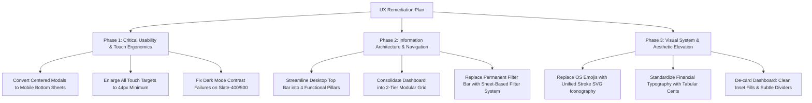

# Comprehensive UX/UI Audit: Personal Finance Tracker

**Application**: Personal Finance Tracker (Angular 18 Frontend / Spring Boot 3.3.2 Backend)  
**Role**: Senior UI/UX Designer, Design Systems Architect & Frontend Analyst  
**Methodology**: Comprehensive static analysis of templates, SCSS/CSS rules, reactive forms, user flows, accessibility contrast ratios, and touch-target heuristics across desktop and mobile viewports.

---

## Executive Summary

The Personal Finance Tracker possesses a remarkably rich functional core—encompassing double-entry style income/expense tracking, budget limits, salary planning with dynamic expense rows, recurring bill cycles, Splitwise group debt settlements with OCR receipt parsing, savings targets, and an automated Gemini AI receipt scanner. 

However, the user experience currently reflects **feature-first engineering accumulation** rather than a unified, intentional financial product. The interface exhibits four macro-level challenges:

1. **Information Architecture & Discovery Friction**: Mobile navigation splits core workflows between a 4-tab bottom navigation bar and a secondary `/more` grid containing 6 critical financial tools (Salary Plan, Recurring Bills, Splitwise, Savings Goals, AI Scanner, Category Management), requiring excessive navigation hops.
2. **Dashboard Cognitive Overload**: The dashboard attempts to display global net metrics, dual salary plan tracking cards, two Chart.js visualizers, upcoming recurring bills, and recent transactions in a single monolithic scroll, stretching past 5 screen heights on mobile.
3. **Form & Modal Ergonomics**: Complex multi-row dynamic forms (Salary Plan budgeting, Splitwise itemized receipt splits, and Add Transaction) render within rigid, centered popup dialogs rather than mobile-optimized bottom sheets or multi-step flows.
4. **Visual Language Inconsistencies**: The design mixes polished SVG Feather/Lucide icons with unstyled OS system emojis (`📇`, `✈️`, `🏠`, `⏰`, `⚡`), exhibits irregular padding and card border radii, and features low-contrast secondary text in dark mode.

---

## Severity Classification Scale

- **P0 — Critical (Blocker / Severe Accessibility Failure)**: Prevents basic task completion, creates risk of catastrophic user error, violates WCAG 2.1 AA accessibility standards, or breaks entirely on small viewports.
- **P1 — High (Usability Friction / Information Architecture)**: Induces significant cognitive strain, hides primary navigation, forces repetitive user effort, or causes layout shifts.
- **P2 — Medium (Visual & Styling Inconsistency)**: Inconsistent spacing, conflicting typography, awkward hierarchy, mismatched icon styles, or suboptimal touch target sizes.
- **P3 — Low (Aesthetic Polish / Micro-Interaction)**: Minor alignment flaws, lack of transition feedback, abrupt dialog appearances, or subtle polish opportunities.

---

## Prioritized Findings Matrix

| ID | Screen / Area | Severity | Category | Issue Summary |
| :--- | :--- | :--- | :--- | :--- |
| **AUD-01** | Global Navigation | **P1** | Information Architecture | 6 core financial modules hidden inside `/more` on mobile |
| **AUD-02** | Dashboard | **P1** | Cognitive Load | Unbounded vertical stack on mobile (5+ viewports scroll) |
| **AUD-03** | Modal Dialogs | **P1** | Mobile Usability | Fixed centered modals for complex forms on mobile viewports |
| **AUD-04** | Global Styling | **P2** | Visual Consistency | Mixed visual icon language: inline SVGs vs unstyled OS emojis |
| **AUD-05** | Form Controls | **P1** | Touch Ergonomics | Form action buttons & table action icons below 44×44px touch targets |
| **AUD-06** | Dark Mode Surfaces | **P2** | Accessibility (A11y) | Muted text (`--slate-500` / `#94a3b8`) fails contrast on dark card fills |
| **AUD-07** | Transaction List | **P2** | Layout & Density | Filter bar consumes excessive vertical viewport before data rows appear |
| **AUD-08** | Splitwise Group Detail | **P1** | Complex Form UX | Dynamic multi-member split calculation lacks visual feedback and error messaging |
| **AUD-09** | AI Receipt Scanner | **P2** | Status Communication | File upload drag-and-drop zone lacks real-time progress indicator & parsing skeletons |
| **AUD-10** | Budgets & Goals | **P2** | Data Visualization | Over-reliance on linear progress bars without pacing or burn-rate trajectory |
| **AUD-11** | Salary Planner | **P1** | Ergonomics | Monolithic table view with nested inputs breaks on tablet viewports (768px–992px) |
| **AUD-12** | Table Row Actions | **P2** | Interaction | Hover-only or cramped inline action buttons (`Edit`, `Delete`) lack confirmation safety |
| **AUD-13** | Numeric Display | **P2** | Typography | Inconsistent decimal placement and currency symbol sizing across screens |
| **AUD-14** | Empty States | **P3** | Empty States | Minimalist text-only empty states without illustrations or guided next steps |

---

## Detailed Audit by Screen & Component

### 1. Global Navigation & Layout Shell
**Impact**: Desktop & Mobile Shell (`NavbarComponent`, `styles.css`)

#### Current State
- **Desktop**: A single sticky header bar containing 9 text navigation links (`Dashboard`, `Transactions`, `Budgets`, `Salary Plan`, `Recurring`, `Splitwise`, `Goals`, `AI Scanner`, `Categories`), plus a Notification bell, Dark Mode toggle button, and User menu.
- **Mobile (< 768px)**: Desktop header collapses to brand logo, theme toggle, and notification bell. A 4-tab bottom navigation bar appears (`Home`, `Transactions`, `Budgets`, `More`) with an elevated center circular Floating Action Button (`+`).
- All remaining 6 sections are accessed by opening `/more`, which renders a static 2-column card grid.

#### Identified Issues
1. **P1 — Deep Navigation Penalty for Everyday Features**: Features like `Splitwise` (shared group bills), `Salary Plan`, and `Recurring Bills` are used frequently, yet require tapping `More` -> scrolling the grid -> tapping the card.
2. **P1 — Rigid Desktop Top Bar Crowding**: 9 text links with notification bell and profile badge begin wrapping or overflowing horizontally between `992px` and `1140px` viewports, causing visual jarring before the mobile breakpoint triggers at `767px`.
3. **P2 — Modal Centering Behind Mobile Keyboards**: When adding an expense on mobile via the center FAB (`+`), the transaction dialog centers vertically. Once the software keyboard opens, the `Submit` button is pushed completely off-screen with no auto-scroll.

#### Design Recommendations
- **Desktop**: Consolidate primary daily management into a streamlined top bar or collapsible sidebar: **Overview** (`Dashboard`), **Activity** (`Transactions`), **Planning** (`Budgets`, `Salary Plan`, `Goals`), and **Collaborative** (`Splitwise`, `Recurring`, `AI Scanner`).
- **Mobile**:
  - Replace the static 4-tab bar with a customizable or swipeable dock: `Home`, `Activity`, `Budgets`, and a configurable 4th slot, plus a bottom sheet **Quick Action Menu** on the center `+` button.
  - Transform all centered modal popups into **Spring-animated Bottom Sheets** (`bottom: 0`, full width, rounded top corners `20px`, native touch handle) that naturally anchor above the virtual keyboard.

---

### 2. Dashboard (`/dashboard`)
**Impact**: Primary user landing experience (`DashboardComponent`)

#### Current State
The dashboard vertically stacks:
1. Header bar with page title, active filter/month selector, and "Add Transaction" CTA.
2. 4 Top KPI cards: Total Balance, Monthly Income, Monthly Expenses, Net Savings.
3. Salary Plan Overview widget (dual comparison cards if an active plan exists).
4. Dual chart containers side-by-side (Income vs Expense Bar Chart, Expense by Category Doughnut Chart).
5. Upcoming Bills & Subscriptions card (list with "Pay Now" actions).
6. Recent Transactions card (table with category badges and view all link).

#### Identified Issues
1. **P1 — Mobile Vertical Fatigue**: On standard mobile screens (393 × 873px), reaching Recent Transactions requires 5 to 6 vigorous scrolls. The user must traverse 4 metric cards, salary widgets, two massive canvas charts, and recurring bills.
2. **P2 — Redundant Card Enclosures**: Every single section is wrapped in an identical heavy white card with a `1px` border and box-shadow (`.card`, `.shadow-sm`). This creates a visual "card prison" where borders fight for attention rather than highlighting hierarchy.
3. **P2 — Fixed Chart Heights on Mobile**: Chart canvas containers have fixed CSS pixel heights (`280px` to `320px`), which consume over 70% of the mobile viewport while displaying only 4–5 data points.
4. **P3 — Lack of Contextual Insights**: The KPI cards show raw dollar amounts (e.g., `$4,850.00`) and a static percentage badge, but do not provide contextual intelligence (e.g., "12% higher than this time last month" or "On track to save $450").

#### Design Recommendations
- **Modular Dashboard Grid**: Introduce a 12-column desktop grid with a compact 2-tier hierarchy:
  - **Tier 1 (Instant Clarity)**: Unified Hero Financial Bar — Net Balance in large display typography (`30px`), flanked by compact Income and Expense pill indicators with sparkline micro-charts.
  - **Tier 2 (Actionable Tabs / Sections)**: Switch between "Overview & Trends" (interactive charts) and "Commitments & Bills" via a segmented toggle on mobile, avoiding infinite vertical stacking.
- **De-carding & Open Surfaces**: Remove heavy card borders for secondary metrics; utilize subtle background fills (`--slate-50` / `#f8fafc`) with hairline dividers (`--border-color`).
- **Mobile Chart Optimization**: Convert the Doughnut chart into a compact horizontal progress bar breakdown with category chips below, saving 180px of vertical space.

---

### 3. Transaction Management (`/transactions`, `/transactions/add`, `/transactions/edit/:id`)
**Impact**: Core daily workflow (`TransactionListComponent`, `TransactionFormComponent`)

#### Current State
- **Transaction List**: Features a prominent multi-field filter card (Search text, Type dropdown, Category dropdown, Start Date, End Date, Min Amount, Max Amount), followed by an actions bar (Export CSV, Add Transaction), followed by a responsive table of transactions.
- Mobile collapses table rows into card items via `@media (max-width: 767px)`.
- **Transaction Form**: Available both as a dedicated route (`/transactions/add`) and as a popup modal dialog.

#### Identified Issues
1. **P1 — Screen Real Estate Hijacking by Filter Bar**: The filter card contains 7 distinct input fields arranged in a grid. On mobile, this filter card occupies over 450px of vertical space, pushing the actual transaction list below the fold before the user has scrolled.
2. **P2 — Inconsistent Amount Presentation**:
   - In some places, amounts are formatted as `+$1,250.00` with green color, while elsewhere they appear as `$1,250.00` without a sign, relying solely on badge coloring.
   - Decimals are rendered at the exact same font size and weight as integer values, reducing scannability for rapid reading.
3. **P2 — Sub-44px Table Row Action Targets**: The `Edit` (pencil icon) and `Delete` (trash icon) buttons in table rows are sized at `28px × 28px` with `4px` padding. On touch devices, this leads to frequent accidental delete taps when intending to edit.
4. **P2 — Hidden Date Grouping**: Transactions are listed strictly sequentially without sticky date headers (e.g., "Today", "Yesterday", "October 14, 2026"), forcing users to read small gray date timestamps to understand chronological context.

#### Design Recommendations
- **Collapsible / Sheet-based Filter System**:
  - Replace the permanent 7-field filter form with a streamlined Search Input paired with a "Filter (0)" badge button that slides out a dedicated Filter Bottom Sheet on mobile.
  - Add quick-filter chips directly under the search bar: `All`, `Expenses`, `Income`, `This Month`.
- **Chronological Date Grouping**: Group transactions by day with sticky section headers displaying the date and net daily cash flow (e.g., "Monday, Oct 19 • -$142.50").
- **Financial Typography Standard**: Standardize the display of amounts:
  - Explicit sign prefixes: `+$` for income (Emerald), `-$` for expenses (Coral/Rose).
  - Subscript or muted styling for decimal cents (e.g., `$1,420`**.50**) to accelerate visual number parsing.
- **Swipe-to-Action Gestures**: On mobile cards, implement iOS-style swipe left for Delete (red background) and swipe right for Edit (teal background), expanding touch targets to full row heights.

---

### 4. Budgets & Savings Goals (`/budgets`, `/savings-goals`)
**Impact**: Financial health and forward-looking guidance (`BudgetListComponent`, `SavingsGoalsComponent`)

#### Current State
- **Budgets**: Displays a Monthly Budget Summary card (Total Budget, Spent, Remaining, Overall % bar), a filter bar, and a grid of budget cards. Each card contains category title, icon, limit, spent, remaining, and a multi-colored progress bar (Green < 80%, Orange 80-100%, Red > 100%).
- **Savings Goals**: Grid of goal cards with target amount, current saved, target date, and a circular or linear completion bar, plus a "Deposit" modal.

#### Identified Issues
1. **P2 — Lack of Velocity / Burn Rate Intelligence**: Current budget progress bars only communicate static percentages (e.g., "75% spent"). They fail to indicate whether 75% spent on Day 10 of a 30-day month is catastrophic, or whether 75% on Day 28 is excellent.
2. **P2 — Visual Alarmism (Color Fatigue)**: Once a user exceeds a budget by $1, the entire card perimeter, progress bar, and badge turn glaring crimson red (`#dc2626`). This induces negative emotional anxiety rather than constructive guidance.
3. **P2 — Fragmented Goal Tracking**: Savings Goals and Category Budgets are isolated into two separate top-level pages despite serving the identical psychological purpose of financial allocation.
4. **P3 — Repetitive Action Buttons**: Every single budget card renders explicit "Edit" and "Delete" text buttons in its footer, cluttering the card grid with visual noise.

#### Design Recommendations
- **Pacing Marker on Progress Bars**: Render a subtle vertical indicator on every budget bar representing the current day of the month (e.g., "Day 19 / 31"). If the fill is to the left of the marker, the user is safely under-pacing; if to the right, they are over-pacing.
- **Refined Emotional Palette**: Replace harsh full-card red fills with an elegant amber-rose indicator and constructive micro-copy (e.g., "$24.00 over planned pacing • 12 days left").
- **Card Action Consolidation**: Move secondary actions (`Edit`, `Delete`, `Adjust Limit`) into a clean top-right three-dots overflow menu (`•••`), reserving prominent card space for the financial progress metric.

---

### 5. Salary Planner (`/salary-plan`)
**Impact**: Income distribution and structured allocation (`SalaryPlanComponent`)

#### Current State
- Displays an Active Salary Plan banner with total salary, fixed allocations, variable spending limits, and projected surplus.
- Features a complex multi-row budgeting table where users allocate portions of their paycheck to Rent, Utilities, Investments, and Debt.
- Plan creation modal contains dynamic row additions (`+ Add Allocation Item`).

#### Identified Issues
1. **P1 — Table Form Layout Breakdown on Mobile**: The multi-row allocation table requires horizontal scrolling on screens `< 768px`, where inputs for "Category", "Planned Amount", "Type", and "Remove" become misaligned with table headers.
2. **P1 — Unverified Allocation Sum Validation**: Users can enter allocation numbers exceeding 100% of their salary, and the form only warns with a small text string at the bottom instead of real-time visual balance tracking.
3. **P2 — Inconsistent Emojis for Categories**: Uses hardcoded OS emojis (`🏠 Rent`, `💡 Utilities`, `🚗 Transport`) which render differently on Windows, macOS, iOS, and Android devices, breaking typographic alignment.

#### Design Recommendations
- **Interactive "Bucket / Envelope" Visualizer**: Replace the rigid data table with a dynamic financial distribution bar (100% stacked segment bar showing Needs, Wants, and Savings in proportional color blocks).
- **Mobile Step-by-Step Allocation**: On mobile viewports, transform the dynamic table into clean stacked allocation cards with slider inputs or numeric steppers, with a sticky bottom summary showing "Remaining to Allocate: $0.00".
- **Custom Curated Icon Set**: Replace OS emojis with consistent stroke-width SVG icons from a single design library (e.g., Lucide Icons).

---

### 6. Splitwise & Shared Expenses (`/splitwise`, `/splitwise/:id`)
**Impact**: Group expense splitting and social peer settlement (`SplitwiseComponent`, `SplitwiseGroupDetailComponent`)

#### Current State
- Group list with total balances (Owed to you vs You owe).
- Group detail view with member list, balance matrix ("Who owes whom"), expense history, and settled history.
- Modal dialogs for "Create Group", "Add Group Expense", "Settle Up", and recently integrated "AI Group Receipt Split".
- Phonebook contact selector with cached lookup.

#### Identified Issues
1. **P1 — Overwhelming Balance Matrix**: In groups with 5+ members, the pairwise debt list ("A owes B $12, B owes C $8") creates excessive cognitive strain. Users simply want to know: "Who do I pay?" and "How much?".
2. **P1 — Multi-payer Split Form Complexity**: The "Add Group Expense" dialog requires choosing split modes (`Equal`, `Exact Amounts`, `Percentages`). When toggled to `Exact Amounts`, dynamic input rows appear with no total recalculation feedback if the sum doesn't match the bill total.
3. **P2 — Dual Close ("X") Buttons and Duplicate Action Headers**: In recent modal iterations, multiple close icon buttons or conflicting header CTAs appeared at both the top and bottom of modal dialogs.
4. **P2 — Unclear Settlement Direction**: Colors for "You are owed" (green) vs "You owe" (red) are occasionally inverted on secondary summary tags, creating confusion about financial obligations.

#### Design Recommendations
- **Simplified Debt Simplification Card**: Prominently display a single hero card at the top of the group: "Your Net Balance: You are owed **$42.50**" with a single direct CTA: "Settle Up".
- **Visual Debt Flow Graph**: In the group details, use directional avatar pill connectors: `[Avatar A] ── $15.00 ──> [Avatar B]` instead of nested tables.
- **Smart Split Wizard**: Structure the Add Expense dialog into 3 guided steps:
  1. *Amount & Description* (or snap photo with AI scanner)
  2. *Who Paid?* (single selector pill)
  3. *How to Split?* (Equal toggle by default, with instant visual balance indicator showing remainder).

---

### 7. AI Receipt Scanner (`/ai-scanner`)
**Impact**: Multimodal expense automation (`ReceiptScannerComponent`)

#### Current State
- Large drag-and-drop file upload target area.
- File selection button accepting PNG, JPG, WEBP, or PDF.
- Preview thumbnail container with image display.
- "Scan with Gemini AI" action button.
- Parsed JSON result card displaying Merchant, Date, Total Amount, Tax, Category, and itemized breakdown with a "Save as Transaction" button.

#### Identified Issues
1. **P2 — Lack of Scanning Feedback & Progress State**: When the user clicks "Scan with Gemini AI", the button enters a simple disabled state with a spinning CSS spinner. There is no skeleton loader, visual OCR scanline effect, or multi-step feedback ("Uploading receipt...", "Analyzing line items...", "Matching categories...").
2. **P2 — Ambiguous Mobile Camera Integration**: On mobile browsers, the upload area triggers the generic OS file picker. It does not provide an explicit "Take Photo" action button utilizing `capture="environment"`, requiring extra user clicks.
3. **P2 — Form Pre-fill Disconnect**: After parsing the receipt, the user must review the items in a separate card and manually confirm. If any line item is misclassified, editing requires navigating to a different modal.

#### Design Recommendations
- **Interactive Camera / Upload Split Button**: Provide two distinct, touch-friendly touch targets on mobile: "📷 Take Photo" and "📁 Browse Files".
- **Animated Shimmer Scanning State**: Implement a high-tech glowing scanline animation over the receipt preview image during API execution, accompanied by dynamic status micro-copy ("Extracting items via Gemini AI...").
- **Inline Editable Breakdown**: Render parsed fields (Merchant, Date, Category, Total) directly as pre-filled, editable form inputs on the same surface so errors can be corrected immediately before single-click saving.

---

### 8. Accessibility (A11y) & Visual Polish Audit
**Standard**: WCAG 2.1 Level AA Compliance

#### Contrast Failures
| Token / Element | Foreground | Background | Actual Ratio | Required AA | Status |
| :--- | :--- | :--- | :--- | :--- | :--- |
| Secondary text (Dark Mode) | `--slate-400` (`#64748b`) | `--bg-surface` (`#111827`) | **3.82:1** | 4.5:1 | **FAIL (P1)** |
| Input placeholder text | `#94a3b8` | `#ffffff` | **2.61:1** | 4.5:1 | **FAIL (P2)** |
| Warning Badge Text | `#d97706` | `#fffbeb` | **3.24:1** | 4.5:1 | **FAIL (P2)** |
| Primary Ghost Button text | `--primary` (`#0f766e`) | `#f0fdfa` | **4.68:1** | 4.5:1 | **PASS** |
| Main Headings | `--slate-900` (`#0f172a`)| `#ffffff` | **16.1:1** | 4.5:1 | **PASS** |

#### Interactive Touch Target Sizes (Mobile)
- Standard Minimum Touch Target: **44 × 44 CSS pixels** (Apple HIG) / **48 × 48 CSS pixels** (Google Material).
- Current Table action buttons (`.btn-icon`, `.btn-sm`): **32 × 32 CSS pixels** (`FAIL`).
- Date picker input triggers: **36px height** (`FAIL`).
- Category selection chips: **28px height** (`FAIL`).
- Bottom Navigation Items: **54px height** (`PASS`).

---

## Actionable Remediation Roadmap

This UX Audit provides the empirical foundation for the subsequent design deliverables: the **Framer Design Brief**, the **Component Specification**, and the **Responsive Specification**.
